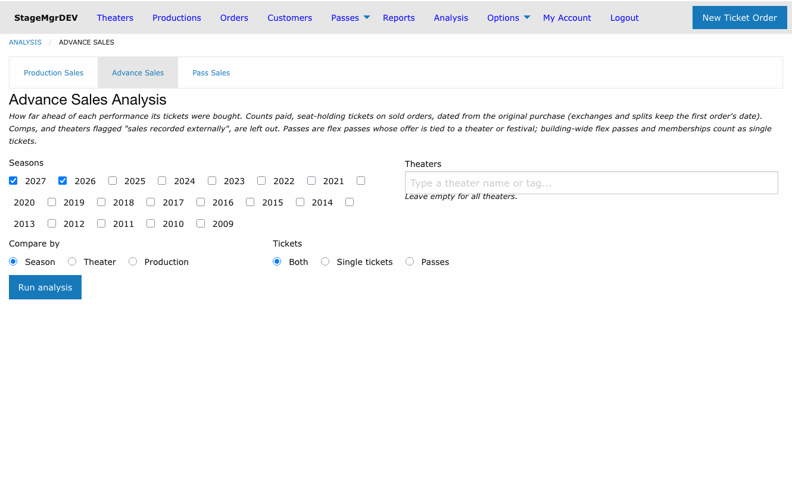
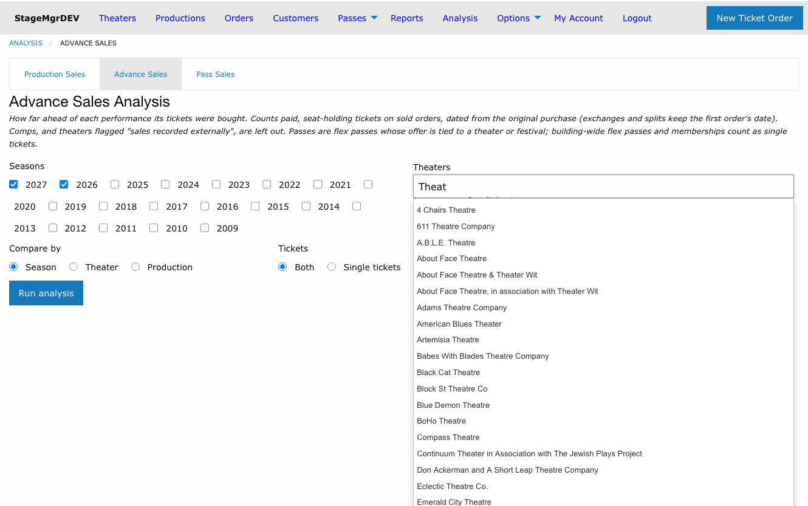
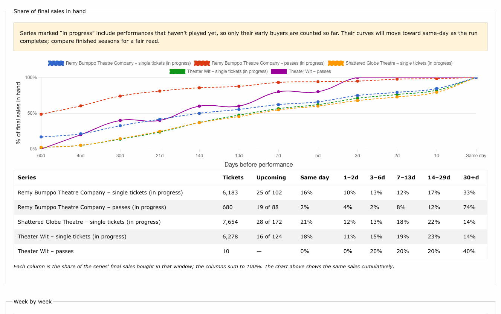
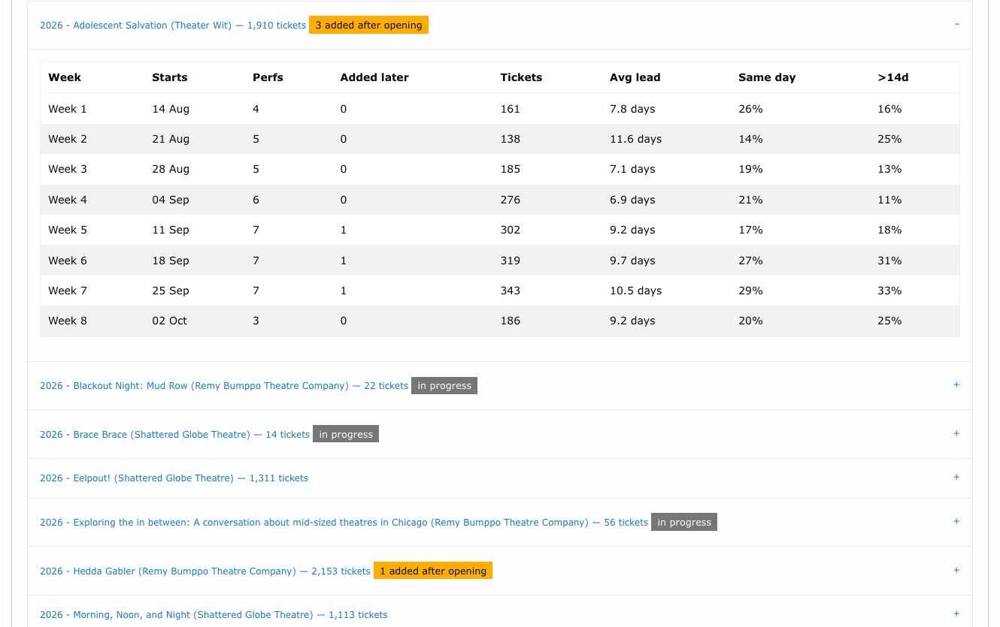
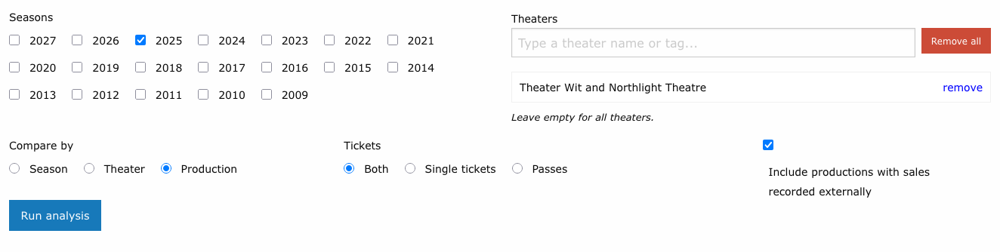
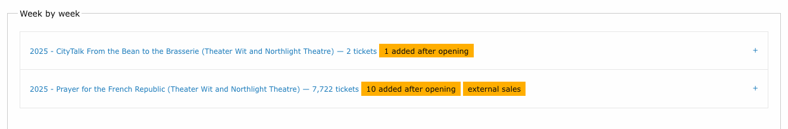
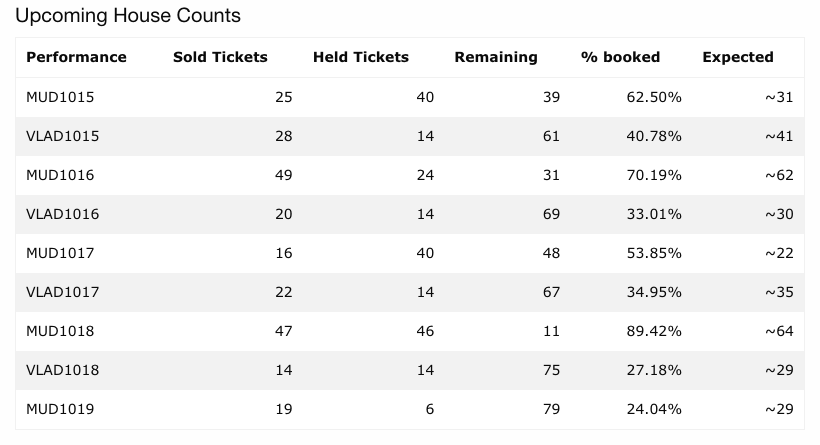

# Advance Sales Analysis

!!! info "Access"
    Advance Sales is available to **Admin** and **Theater** users. Box Office users do
    not have access. Theater users see only productions belonging to their theaters, and
    only their own theaters in the theater picker.

**Navigation:** Admin Menu > Analysis > **Advance Sales** tab

!!! tip "Shortcut from a production"
    On any production's admin page (Productions > [Production Name]), click the
    **Advance Sales** button next to *Audience Analysis*. It opens the form with that
    production's theater and season selected and the comparison set to **Production**.

---

## What it answers

Advance Sales looks at *when* tickets were bought relative to the performance they were
bought for:

- How far ahead do patrons plan? What share of a show's tickets are bought the same day,
  the week before, or a month or more out?
- Is that changing over time? Compare seasons for one company or for the whole building.
- Does it differ from company to company? Compare theaters side by side.
- What does a run look like week by week, and how did performances added after opening
  sell compared with the original run?

A related **Expected** column on upcoming house counts uses the same history to project
where an upcoming performance is heading. See
[Expected sales on house counts](#expected-sales-on-house-counts).

## Running the analysis

| Field | What it does |
|-------|--------------|
| **Seasons** | Tick one or more seasons. The two most recent seasons are ticked on your first visit. At least one is required. |
| **Theaters** | A typeahead picker. Type part of a theater's name or a [tag](../setup/theaters.md#tags); choose a theater to add it, or an **All theaters tagged ...** entry to add every member of that tag in one click. Remove rows individually or with **Remove all**. Leave the list empty to include every theater you can see. If you have access to only one theater, the picker is not shown and the analysis uses that theater. |
| **Compare by** | What each line on the chart represents: a **Season**, a **Theater**, or a **Production**. |
| **Tickets** | **Both** draws a single-ticket line and a pass line per group; **Single tickets** or **Passes** draws one line per group. See [What counts](#what-counts). |
| **Include productions with sales recorded externally** | Shown only when you can see such a production. Off by default. See [Sales recorded externally](#sales-recorded-externally). |

Results are bookmarkable: the address bar carries the full selection, so you can share
or revisit a run. Changing any filter clears the results until you click **Run analysis**
again.

## Reading the results

### The chart: share of final sales in hand

Each line answers, for one series, "how much of this group's eventual ticket total had
already been sold N days before the performance?" The x-axis runs from 60 days out to the
day of the show, and every line climbs to 100% at **Same day**. A line that sits high on
the left belongs to an audience that plans ahead; a line that stays low until the last
week belongs to a walk-up audience. The steepest stretch of a line is the window in which
most of its tickets sold.

### The table: sales by window

The table under the chart shows the same sales a different way. Each column is the share
of the series' final sales bought in that window -- **Same day**, **1-2d**, **3-6d**,
**7-13d**, **14-29d** and **30+d** -- so a row adds up to 100%. Read the chart for the
shape of the curve and the table for how much landed in each window.

| Column | Meaning |
|--------|---------|
| **Tickets** | Tickets counted in the series. |
| **Upcoming** | For a series still in progress, how many of its performances with tickets sold have not yet played, out of its total. A dash for a finished series. |
| **Same day ... 30+d** | Share of final sales bought that many days before the performance. |

!!! warning "Series in progress"
    A performance that hasn't played yet has no final total: only its early buyers exist
    so far. A series that includes such performances is labelled **(in progress)**, drawn
    with a dashed line, and listed with an **Upcoming** count. Its curve will move toward
    same-day as the run completes. Compare finished seasons for a fair read, and treat an
    in-progress season as provisional.

!!! note "Small series"
    A line built from a handful of tickets is a sample, not a pattern. Check the
    **Tickets** column before drawing conclusions from a flat or stepped line.

### Week by week

Below the comparison, one collapsible panel per production breaks its run into weeks
counted from the production's first playing date (first preview, press opening or
opening, whichever comes first). Expand a panel to see:

| Column | Meaning |
|--------|---------|
| **Week** | **Week 1** is the first seven days of the run; **Week before** is the seven days before it; **Earlier** collects anything before that. |
| **Starts** | The first date of that week. |
| **Perfs** | Performances in the week with tickets sold. |
| **Added later** | Performances that were first activated after the run had started -- typically an extension. The panel title also shows the production's total as **N added after opening**. |
| **Tickets** | Tickets sold for performances in the week. |
| **Avg lead** | Average days between purchase and performance, weighted by tickets. |
| **Same day** | Share bought on the day of the performance. |
| **>14d** | Share bought more than two weeks ahead. |

A **N upcoming** label on a week means that many of its performances have not played yet.

!!! tip "Extensions"
    Added performances sell to a different crowd. Across the building, extension weeks run
    roughly 40% same-day against about 25% in an opening week, so an added week leans on
    late buyers and word of mouth. The **Added later** column lets you see how a specific
    extension sold relative to the original run.

## What counts

Only Active performances are counted; Private and Inactive performances are left out.

- **Tickets** are seat-holding, non-complimentary tickets on sold ticket orders, the same
  basis as house counts. Comps are left out, as are add-on items that don't occupy a
  seat.
- **The sale date** is the original purchase. An exchanged or split order is traced back
  to the first order, so moving a ticket to a different night doesn't change when the
  patron decided to buy.
- **Lead time** is the number of days between that purchase date and the performance
  date. A purchase on the day of the show is **Same day**.
- **Passes** are tickets paid with a flex pass whose offer is tied to a specific theater
  or festival -- the kind of pass sold as a subscription. Tickets paid with any other
  pass, with a membership, or in cash or card count as **single tickets**. Purchases of
  passes and memberships themselves are not ticket sales and are never counted.

### Sales recorded externally

Some productions sell through another venue's box office and have their tickets keyed
into Stagemgr afterwards. For those the order date is the data-entry date, not the
purchase date, so their lead times are meaningless and would distort any comparison. Tick
**Sales recorded externally** on the
[production form](../productions/creating-a-production.md#sales-recorded-externally)
to keep such a production out of Advance Sales by default. The form offers a checkbox to
include them in a run deliberately.

Included productions carry an **external sales** label in the week-by-week list, so a run
that mixes the two kinds says which is which.

## Expected sales on house counts

**Expected** is the paid count the performance is expected to have at curtain if it sells
the way this house usually does. It already includes the tickets sold so far; held tickets
and comps are not part of it.

For example, MUD1019 is six days out with 19 paid tickets. At this theater, performances
six days out have typically sold about two thirds of their final count, so 19 ÷ 0.66 gives
~29 expected at curtain, about ten more between now and show time.

On the day of the show, Expected is worked out from the tickets bought before that day and
the share this house typically has in hand by show-day morning, so it keeps anticipating
walk-ups and does not fall overnight. The hover text then reads, for example, "Sold 19
before today; this house typically has 79% in hand by show day".

You see it in two places:

- **Upcoming House Counts** on your account page (the page you land on after signing in,
  shown to theater users and administrators). The last column, **Expected**, reads
  **~29**. Hover over it for the basis, for example "Sold 19 as of Oct 13; this house
  typically has 66% in hand 6 days out".
- The HUD file `house_counts.txt`, as a right-aligned **Expected** column (`~29`). It is
  blank when there is nothing to project, it is too early, or Sold has already passed it. See
  [HUD Display](../house-management/hud-display.md).

| Reading | Meaning |
|---------|---------|
| **~N** | Paid tickets expected at curtain, including those already sold. |
| **Too early** | The theater typically has under 10% in hand this far out, so a projection would be noise. |
| **--** | The performance has played, is inactive, the production's sales are recorded externally, or there is not enough history to project from. |
| **--** (with hover text) | The **Sold** column has already passed the expected count; the hover text says so. |

The history is the theater's earlier seasons, leaving out any production whose sales are
recorded externally; such a production is never projected either. A theater with fewer
than 1,000 tickets of history uses the building-wide curve instead, and the hover text
ends with "(building-wide curve)". Expected is not affected by in-progress seasons, because it
only ever looks at seasons before the production's own.

The "Sold" figure Expected projects from counts paid, seat-holding tickets, leaving out
complimentary ones, each dated by its original purchase. It can therefore be a little
under the row's **Sold** column, which includes comps.

The projection is stored on each performance's house count. It is refreshed whenever that
performance's house count is recalculated (on every sale, hold or cancellation, and in the
5-minute sweep) and by a nightly pass at 4:40 AM (`ProjectHouseCountsJob`) that
re-projects every upcoming performance, so a performance with no new sales still moves
along the curve as its date approaches.

!!! note
    Expected is a projection from typical behaviour, not a forecast of this show. A strong
    review, a snowstorm, or a late press push will move a performance off its house's
    usual curve.
