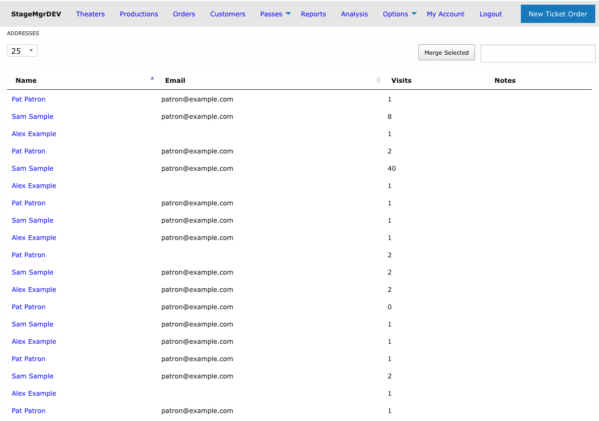

# Merging Duplicate Patrons

!!! info "Role: Administrators Only"
    Merging duplicate patron records is a permanent, irreversible operation restricted to administrators. Use caution and verify selections before confirming a merge.

**Navigation:** Admin > Addresses > Merge Selected, or **Merge** on the LGL Review list of the [LGL Sync Status page](lgl-sync.md#the-sync-status-page)

---

## When Duplicates Arise

Duplicate patron records are created when:

- A patron purchases tickets using a different name variation (e.g., "Bob Smith" vs. "Robert Smith").
- Online purchases create a new record because the email or name does not exactly match an existing entry.
- Box office staff create a new record without checking for an existing one.
- A patron uses different email addresses for separate purchases.
- Group orders or will-call entries generate placeholder records that overlap with real patron records.

!!! tip
    Regularly reviewing patron records for duplicates helps maintain clean data. Look for patrons with the same email address, similar names, or identical phone numbers.

---

## How to Merge Duplicates

1. Navigate to **Admin > Addresses**.
2. Search for the patron whose duplicates you want to consolidate.
3. Identify all duplicate records in the search results.
4. Click each duplicate record's row to select it. **Merge Selected** is
   available when two to four rows are selected.
5. Click **Merge Selected**. The Merge customers page opens.
6. Choose the values to keep, check the summary, and click **Merge into #id**.

---

## The Merge Customers Page

The page shows the selected customers side by side, one column per customer
in order of customer ID. Each column heading is the customer's ID and name,
linking to their page. The first column is the **master**: the original record
(lowest ID), which is kept. Every other record is merged into it and deleted.

The rows are **Name**, **Street address**, **Email**, **Phone** and **LGL
constituent**, followed by **Active member**, **Donor**, **Orders** and
**Last order** for reference.

- Where the customers' values differ, each value has a radio button. Choose
  the one the master should end up with. Each starts on the newest record
  that has a value.
- Where they do not differ (the same value, or only one record has one), the
  values are shown as plain text and there is nothing to choose.
- The street address is one value: street, city, state and ZIP all come from
  the record you choose, so no part of another record's address is mixed in.

Each column heading has an **Exclude** link. An excluded customer is shown
greyed out with "(excluded, not merged)": it is not merged and keeps its own
record, and its values cannot be chosen. **Include** brings it back into the
merge. At least two customers must remain, so the Exclude links disappear when
only two are left. Excluding the master makes the next-lowest ID the master.

When the customers have different first names, a warning names them: they may
be a household rather than one person. If one of them is a different person,
exclude that record and merge the rest.

Below the table, a summary says which record is kept and which are deleted,
which values come from records other than the master, and how many orders and
memberships move to the master. It updates as you change the choices. When
you came from the LGL Review list it also says the master will be re-linked to
the LGL constituent, and the page shows the constituent's number with a
**View in LGL** link when the LGL web address is configured.

Click **Merge into #id** to merge, or **Cancel** to go back without changing
anything. After a merge from the Customers page you land on the master's
page; after a merge from the LGL Review list you return to the LGL Sync
Status page.

---

## Original and Newer Records

A merge always keeps the **original** record, the one with the **lowest ID**
(the one created first), and folds each **newer** record into it. The newer
records are then deleted.

The original record is kept because it usually carries the most history:
past orders, memberships and attendance. Folding the newer records in moves
only their smaller amount of activity, such as a recent order, onto the
patron's established record.

---

## Merge Rules

| What | Result |
|------|--------|
| Which record is kept | The original record (lowest ID). Newer records are deleted after the merge |
| Name, street address, email, phone | The values chosen on the Merge customers page. Each defaults to the newest record that has a value, so a blank never wins by default |
| LGL ID | The one chosen on the page. Any other LGL constituent the records were linked to is noted in an `LGL Review` tag on the original record, asking for the constituents to be merged in LGL |
| Tags for different theaters | Kept side by side. Two tags with the same label, such as `External ID`, both end up on the original record when each belongs to a different theater |
| Tags with the same label for the same theater | The newer record's value replaces the original's. Only one tag remains |
| Tags only on the newer record | Moved to the original record |
| `LGL Review` tags | Merging on the Merge customers page removes them from the original record: merging is how the review is resolved. The only one that stays is the flag the merge itself raises when the records were linked to different LGL constituents. Automatic duplicate consolidation does not remove them; the newer record's `LGL Review` tag replaces the original's like any other tag |
| VIP and placeholder flags | Set on the original if either record had them |
| Donor levels | The newer record's donor level, when it has one |
| Photo | Copied from the newer record only if the original has none |
| Orders, including gifts the patron received | Moved to the original record |
| Memberships and flex passes | Moved to the original record |
| Payments, pledges and donation history | Moved to the original record |
| Productions attended | Combined on the original record |

!!! warning
    The merge operation is **permanent and cannot be undone**. The newer records are removed from the system after their data is moved. Always double-check that you have selected the correct records before confirming.

---

## Merging More Than Two Records

You can merge up to four records at once. Stagemgr keeps the one with the
lowest ID and folds the others into it, from the next-lowest ID to the
highest. Name, street address, email, phone and LGL ID come from the records
you chose on the page; for the other details in the table above, the newest
record's values win wherever it has them.

The whole merge succeeds or fails as one. If any part fails, no record is
changed and the page shows the error.

---

## Before You Merge

Review the following checklist before performing a merge:

- [ ] Verify that the records truly belong to the same person.
- [ ] Check the chosen name, street address, email, phone and LGL constituent on the Merge customers page.
- [ ] Read the summary below the table: which record is kept, which are deleted and what moves.
- [ ] Review tags on all records. A tag on the newer record replaces the original's tag with the same label for the same theater, and any `LGL Review` tag is removed by the merge.
- [ ] Confirm you have administrator access.

---

## Handling Contact Information Conflicts

Choose the better value on the Merge customers page. For example:

| Scenario | Action |
|----------|--------|
| The newer record has an outdated address and the original's is correct | Choose the original's street address |
| The patron's preferred email is on the original record | Choose the original's email |
| The name is spelled correctly only on the original record | Choose the original's name |

Details the page does not offer, such as tags, flags and donor levels, follow
the [Merge Rules](#merge-rules). Correct them on the newer record before
merging, or on the original afterwards.

---

## Common Merge Scenarios

| Scenario | Recommended Approach |
|----------|---------------------|
| Same person, different email addresses | Choose the preferred email on the Merge customers page |
| "Bob" vs. "Robert" with same last name and email | Safe to merge. Choose the spelling to keep |
| Same name but different addresses | Verify they are the same person (check order history, phone) before merging |
| Placeholder record alongside a real patron record | The merged record keeps the placeholder flag if either record had it. Clear the flag on the patron's record after merging |
| More than two duplicates | Select up to four at once and choose each value on the page |

---

## Restrictions

- Only users with **administrator** privileges can perform merges.
- Records associated with finalized orders can be merged (their orders move to the original record), but individual records with finalized orders cannot be deleted outside of the merge process.
