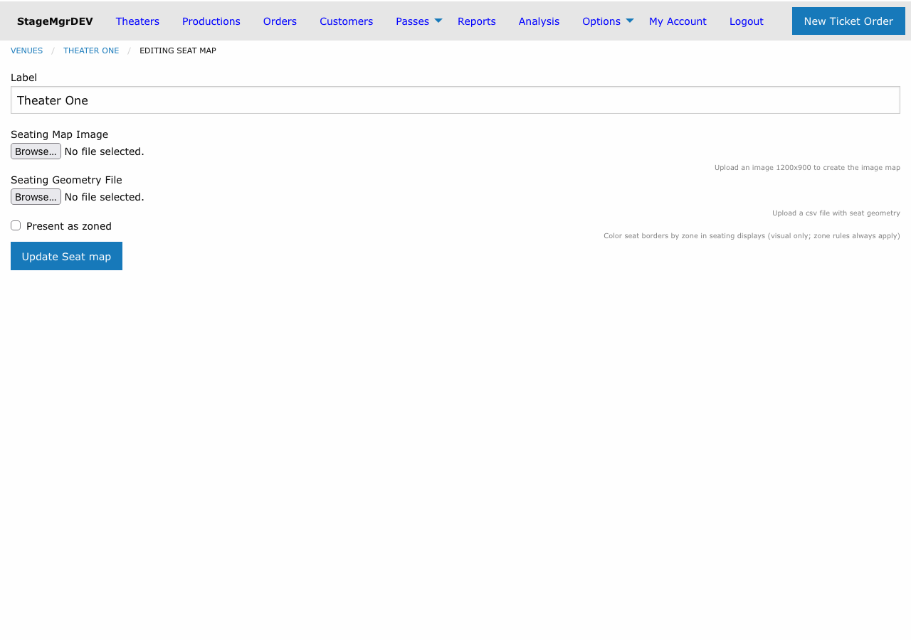
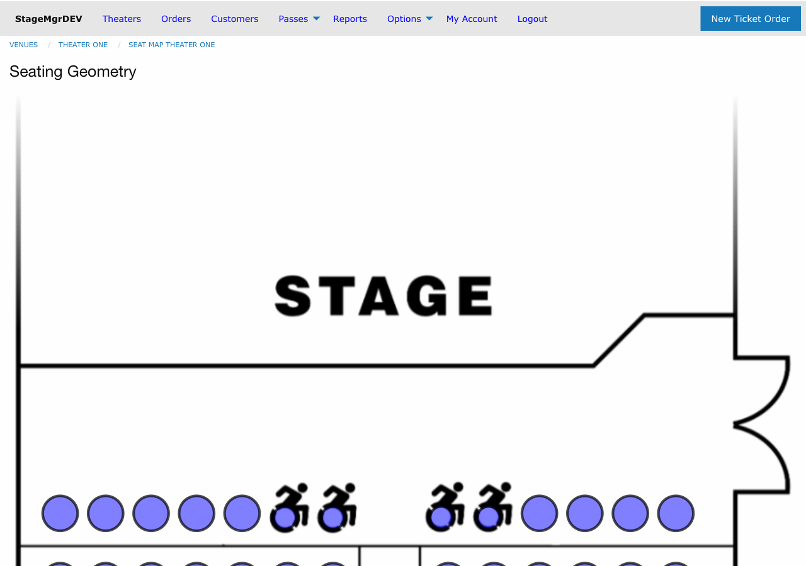

# Seat Maps

!!! info "Required Role"
    **Administrator** or **Box Office** can create and edit seat maps. Only **Administrators** can delete seat maps.

**Navigation:** Options > Venues > [select a venue] > Seat Maps, or directly via the seat maps list

## What Is a Seat Map?

A **seat map** defines the seating layout for a reserved-seating venue. It consists of:

- A **base image** showing the physical layout of the space (stage, aisles, sections)
- A set of **seats** with row and location identifiers, positioned on the image using coordinate geometry

When a seat map is assigned to a production, that production becomes a **reserved seating** production -- patrons select specific seats during ticket purchase. The production's capacity is automatically set to the number of seats in the assigned seat map.

## Creating a Seat Map



1. Navigate to the seat maps list
2. Click **New Seat Map**
3. Fill in the form:

| Field | Required | Description |
|-------|----------|-------------|
| **Label** | Yes | A descriptive name for this seat map (e.g., "Mainstage Standard", "Studio Cabaret Layout") |
| **Seating Map Image** | Yes | Upload an image file (JPG, PNG, GIF) showing the venue layout. Recommended size: **1200x900 pixels**. This image is displayed as the background when patrons and staff select seats. |
| **Seating Geometry File** | No | Upload a CSV file defining each seat's position on the image. See format below. |
| **Present as zoned** | No | When checked, seating displays color each seat's border by its zone. Visual only -- zone matching rules always apply. See [Seat Zones and Zoned Pricing](seat-map-editor.md#seat-zones-and-zoned-pricing). |

4. Click **Create Seat Map**

## Seat Geometry CSV Format

The geometry CSV file defines the position and properties of each seat. Each row in the CSV creates one seat, drawn on the map as a **circle**.

The first row must be a header row naming the columns. Columns can be in any order.

### Required Columns

All eight of these column headers must be present in the file, even when a column's values are left blank. If one is missing, nothing is imported and a message names the missing column.

| Column | Description | Example |
|--------|-------------|---------|
| `location` | Unique seat identifier. Must be filled in and unique within the seat map. | `A1`, `B12`, `AA3` |
| `row` | Row designation. Must be filled in. | `A`, `B`, `AA` |
| `sequence` | Seat number within the row. Must be a whole number of 1 or more. | `1`, `2`, `12` |
| `origin-x` | X coordinate of the **center** of the seat's circle, in pixels from the left edge of the map image. Must be a whole number of 0 or more. | `150` |
| `origin-y` | Y coordinate of the **center** of the seat's circle, in pixels from the top edge of the map image. Must be a whole number of 0 or more. | `300` |
| `width` | **Radius** of the seat's circle in pixels (not its full width). A seat with `width` 10 is drawn 20 pixels across. Must be a whole number of 1 or more. | `10` |
| `height` | Not used when drawing the seat. The column must be present; repeat the `width` value or leave it blank. | `10` |
| `feature` | Accessibility designation -- if set, indicates the seat can be converted to wheelchair accessible. Leave blank for an ordinary seat. | `wheelchair` |

Coordinates are measured in pixels of the uploaded map image at its original size, so a seat at `origin-x` 150, `origin-y` 300 is centered 150 pixels from the left and 300 pixels down from the top of the image.

### Optional Columns

| Column | Description | Example |
|--------|-------------|---------|
| `zone` | Seating zone for [zoned pricing](seat-map-editor.md#seat-zones-and-zoned-pricing) (1--2 letters/digits; defaults to `A`). When the column is absent, re-imports leave existing zones untouched. | `B` |

### Example CSV

```csv
location,row,sequence,origin-x,origin-y,width,height,feature
A1,A,1,100,400,10,10,
A2,A,2,125,400,10,10,
A3,A,3,150,400,10,10,wheelchair
B1,B,1,100,430,10,10,
B2,B,2,125,430,10,10,
```

Here each seat is a circle 20 pixels across, and the centers in a row are 25 pixels apart, leaving a 5-pixel gap between neighbors.

!!! tip "Sizing and spacing"
    Because `width` is a radius, two neighboring seats overlap when their centers are closer together than twice the `width`. The [Seat Map Editor](seat-map-editor.md) shows the same value as **Radius** and lets you adjust it, and drag seats into place, after the import.

### What You See After an Import

When the seat map is saved, a message reports how many seats were imported from the file.

| Situation | What happens |
|-----------|--------------|
| A required column header is missing | Nothing is imported and the seat map is not created or changed. The form is shown again with a message naming the missing column(s). |
| The file is empty or cannot be read as a CSV | Nothing is imported and the seat map is not created or changed. The form is shown again with a message. |
| A row has a blank `location`, `row` or `sequence`, an invalid `zone`, or a `sequence`, `origin-x`, `origin-y` or `width` that is blank or not a whole number in the allowed range (for example `abc`, `12.5`, or a `sequence` of `0`) | That row is skipped and the rest of the file is imported. If the row's location is already on the seat map, that seat is left as it was. A warning lists each skipped row by its line number in the file (the header row is line 1), with its location and the reason. Only the first 10 skipped rows are listed, followed by a count of the rest. |
| Two rows share a `location` | The later row overwrites the earlier one. |

Fix the listed rows in your file and upload it again from the seat map's edit form; rows that already imported are simply updated.

## How Seat Maps Work



### Capacity

A seat map's **capacity** equals the total number of seats it contains. When a production is assigned this seat map, the production's capacity is automatically set to this count -- you cannot manually override it.

### Seat Inventory

When a new performance is created for a reserved-seating production, Stagemgr automatically creates a **seat assignment** record for every seat in the map. These assignments track which seats are available, held, or sold for each performance.

### Accessible Seating

Seats with a `feature` value (e.g., `wheelchair`) are flagged as **accessible**. During ticket sales, box office staff can convert these seats to wheelchair-accessible seating as needed.

## Updating a Seat Map

You can edit an existing seat map to:

- Change the **label**
- Upload a new **base image** (replaces the existing one)
- Upload a new **geometry file** (updates seat positions; adds new seats for locations not already in the map)

!!! warning
    Uploading a new geometry file adds or updates seats but does **not** remove existing seats. To remove a seat, use the [seat map editor](seat-map-editor.md). Seats that have been assigned to orders cannot be removed.

### The Seat Map Editor

For day-to-day adjustments, the graphical [**Seat Map Editor**](seat-map-editor.md) is usually faster than re-importing a CSV. Open it from the **Open Seat Map Editor** button on the seat map's detail page to drag seats into position, add or delete seats, resize the markers, and paint pricing zones -- all with an explicit Save.

## Deleting a Seat Map

Only **Administrators** can delete seat maps, and only when the seat map is **not assigned to any production**. If a seat map is in use, you must first remove the seat map assignment from all productions using it.

## Assigning a Seat Map to a Production

Seat maps are assigned to productions during production setup:

1. When creating or editing a production, select a **Venue**
2. Once a venue is selected, the **Seat Map** dropdown shows all seat maps for that venue
3. Select a seat map to enable reserved seating, or leave it blank for general admission

See [General vs Reserved Seating](../productions/general-vs-reserved.md) for more details.
